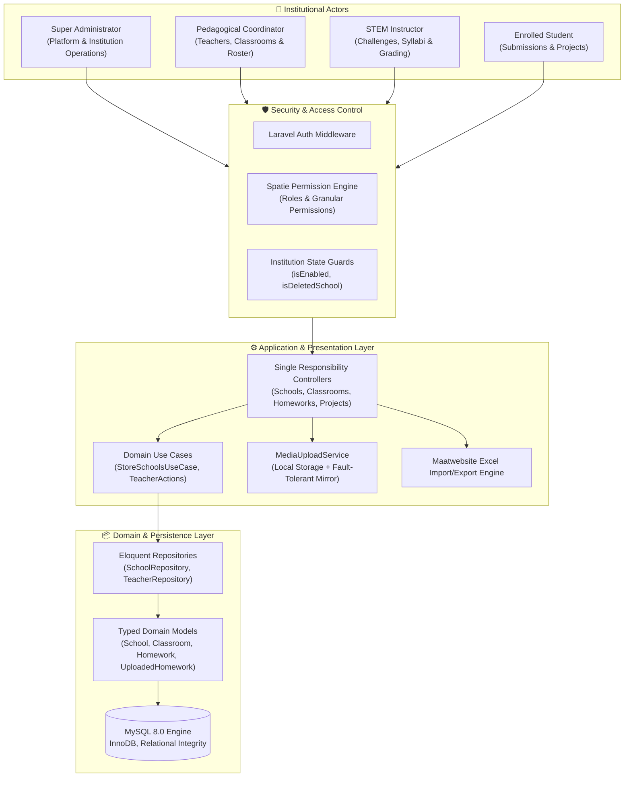
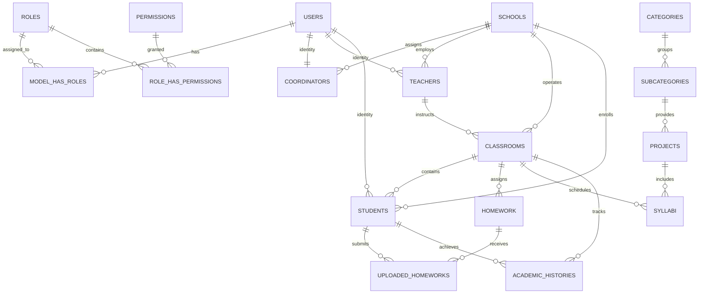

# LMS Robotics Learning Platform

[](https://github.com/KevinAndrey96/lms-robotics-learning-platform/actions/workflows/ci.yml)
[](https://www.php.net/)
[](https://laravel.com/)
[](https://www.mysql.com/)
[](https://www.docker.com/)
[](https://spatie.be/docs/laravel-permission/)

A full-stack Educational Learning Management System (LMS) and Academic ERP platform designed for schools, academies, and institutions teaching robotics, electronics, computational thinking, and STEM disciplines to primary and secondary students.

The platform orchestrates the complete academic lifecycle across multi-tier educational institutions: from school onboarding and coordinator governance, to classroom curriculum assignment, teacher challenge scheduling, student homework submissions (PDF, DOCX, ZIP), project repositories, and gradebook evaluations with automated Excel and PDF reporting.

---

## 🏛️ System Architecture

The platform follows a layered clean architecture pattern, combining Single Responsibility Action Controllers, Domain Use Cases, Contract Interfaces, Eloquent Repositories, and a resilient Media Upload Service:



---

## 🗄️ Relational Domain Model (ERD)



---

## 👥 Multi-Tier Role & Permission Matrix (RBAC)

The system enforces strict Role-Based Access Control powered by `spatie/laravel-permission` and custom institutional security middlewares:

| Capability / Module | Administrator | Coordinator | Teacher | Student |
| :--- | :---: | :---: | :---: | :---: |
| School Management (Create, Edit, Soft Delete, Enable/Disable) | ✅ Full | ❌ | ❌ | ❌ |
| Pedagogical Coordinators Directory & Assignment | ✅ Full | ❌ | ❌ | ❌ |
| Curricular STEM Categories & Subcategories | ✅ Full | ❌ | ❌ | ❌ |
| Teachers & Instructors Onboarding | ❌ | ✅ Full | ❌ | ❌ |
| Classrooms Creation, Coding & Capacity Management | ❌ | ✅ Full | 👁️ View | ❌ |
| Student Enrollment & Classroom Transfers | ❌ | ✅ Full | 👁️ View | ❌ |
| Curricular Syllabus Planning & Project Association | ✅ Full | 👁️ View | ✅ Manage | 👁️ View |
| Challenge Assignment (Homework creation, deadlines) | ❌ | ❌ | ✅ Full | ❌ |
| Deliveries & Submissions (PDF, DOCX, ZIP file upload) | ❌ | ❌ | ❌ | ✅ Submit |
| Evaluation, Scoring & Academic History Feedback | ❌ | ❌ | ✅ Grade | 👁️ View |
| Bulk Student/Teacher Import and Export (Excel) | ✅ Full | ✅ Full | ❌ | ❌ |

---

## 🔬 STEM Curricular Tracks & Educational Modules

The platform includes pre-configured learning tracks covering primary and secondary school robotics education:

| Track / Category | Core Disciplines | Practical Classroom Focus |
| :--- | :--- | :--- |
| **Robótica y Mecatrónica** | Kinematics, Gears, Servomotors, Actuators | Articulated robot arms, chassis design, high-speed line followers |
| **Programación y Algoritmia** | Visual Blocks, Scratch, Python Embedded | Algorithmic logic, control loops, obstacle evasion code |
| **Electrónica y Circuitos** | Breadboards, LEDs, Microcontrollers | Arduino sensor reading, Micro:bit wearable indicators, acoustic alerts |
| **Diseño e Impresión 3D** | Volumetric Modeling, Tinkercad, Prototyping | Custom structural joints, wheel hubs, sensor mounting brackets |
| **IA e IoT Escolar** | Basic Machine Vision, Smart Classrooms | Environmental telemetry (temp/humidity), color recognition triggers |

---

## ⚡ Key Capabilities & Technical Highlights

### 1. Pedagogical & Classroom Life Cycle
- **Institutional Governance**: Multi-school tenancy allowing central administrators to onboard regional schools and appoint coordinators.
- **Roster Enrollment & Transfers**: Automated student registration with classroom transfer workflows preserving historic evaluations.
- **Dynamic Syllabi**: Assignment of project-based curriculum units to specific classroom sections with student interactive access.

### 2. Challenge & Homework Submissions
- **Deadlines & Status Machine**: Assignments track delivery dates with states (`notUploaded`, `send`, `scored`).
- **File Validation & Storage**: Multi-format submissions (PDF, DOCX, ZIP, images) stored through `MediaUploadService`.
- **Gradebook & History**: Direct scoring by instructors updating `academic_histories` records for end-of-term evaluations.

### 3. Resilient Media Architecture (`MediaUploadService`)
- Replaces legacy hardcoded HTTP upload calls with a unified, clean service layer.
- Ensures all institutional logos, category icons, project guides, and student deliverables are saved to local public storage with deterministic naming.
- Features optional non-blocking remote mirroring that gracefully handles network latency without failing local transactions.

### 4. Bulk Data Migration & Reporting
- Integrated **Maatwebsite Excel** engine (`phpoffice/phpspreadsheet`) for mass onboarding of students and teachers.
- Print-ready PDF report generation using **DomPDF**.

---

## 🚀 Quickstart with Docker Compose

### Prerequisites
- Docker (version 20.10 or higher)
- Docker Compose (v2)

### 1. Clone & Configure Environment

```bash
git clone git@github.com:KevinAndrey96/lms-robotics-learning-platform.git
cd lms-robotics-learning-platform

# Generate local environment file from sanitized template
cp .env.example .env
```

### 2. Start Services

```bash
docker compose up -d
```

This starts:
- **Web Application**: Nginx on `http://localhost:8080`
- **Application Runtime**: PHP 8.1 FPM container
- **Database Engine**: MySQL 8.0 on `localhost:3306` with auto-initialized schema and seed data
- **Caching & Sessions**: Redis 7.0 on `localhost:6379`
- **Mail Testing Sandbox**: Mailpit Web UI on `http://localhost:8025` (SMTP port `1025`)

### 3. Seed Accounts & Credentials

The seed dataset provides pre-configured credentials for every role in the platform:

| Role | Email | Password | Assigned Context |
| :--- | :--- | :--- | :--- |
| **Super Administrator** | `admin@admin.com` | `password` | Global platform administration |
| **Coordinator** | `miel@gmail.com` | `password` | Colegio Claretiano de Bosa |
| **Coordinator** | `claretiano@gmail.com` | `password` | Colegio Mayor de Mazuera |
| **Teacher** | `carlos@gmail.com` | `password` | Instructor (Robótica Móvil 607) |
| **Teacher** | `davidca@gmail.com` | `password` | Instructor (Robótica Industrial 802) |
| **Teacher** | `claudia@gmail.com` | `password` | Instructor (Domótica Infantil 305) |
| **Student** | `student@student.com` | `password` | Student enrolled in Robótica 607 |
| **Student** | `fernandohu@gmail.com` | `password` | Student enrolled in Robótica 607 |

---

## 🧪 Automated Testing & Verification

Run automated linting, test suite, and database integrity checks:

```bash
# Verify database schema integrity and table records count
docker compose exec app php database/verify_database.php

# Run unit and feature tests
docker compose exec app php artisan test
```

Using the included `Makefile`:

```bash
make up        # Start all containers in background
make down      # Stop and preserve container state
make test      # Run full PHPUnit test suite
make verify    # Execute database verification script
make bash      # Open shell in PHP-FPM application container
```

---

## 📄 License

This software is released under the **MIT License**.
