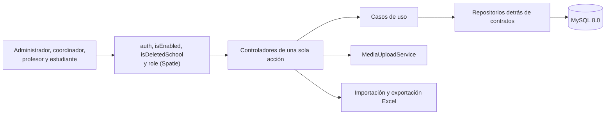

# Plataforma LMS de robótica educativa (Laravel)

[](https://github.com/KevinAndrey96/laravel-lms-robotics-learning-platform/actions/workflows/ci.yml)


Sistema de gestión de aprendizaje para colegios que enseñan robótica, electrónica y pensamiento computacional en primaria y secundaria. Cubre el ciclo académico completo: alta de colegios y coordinadores, cursos y matrícula de estudiantes, temas por categoría, planes de estudio, tareas con entrega de archivos, calificaciones e historial académico.

Proyecto desarrollado para un cliente. El repositorio se publica como muestra de portafolio.

## Roles

El acceso se controla con `spatie/laravel-permission`: el menú y las rutas usan los mismos roles, y los middlewares `isEnabled` e `isDeletedSchool` cierran la sesión de usuarios deshabilitados o de colegios eliminados.

| Módulo | Administrador | Coordinador | Profesor | Estudiante |
| :--- | :---: | :---: | :---: | :---: |
| Colegios, administradores y coordinadores | ✅ | | | |
| Categorías, subcategorías y aprobación de temas | ✅ | | | |
| Importación y exportación de usuarios (Excel) | ✅ | ✅ | | |
| Profesores, cursos, matrícula y traslados | | ✅ | | |
| Consulta de cursos y estudiantes | | ✅ | ✅ | |
| Tareas, calificaciones y planes de estudio | | ✅ | ✅ | |
| Temas propios (proyectos) | ✅ | ✅ | ✅ | ✅ |
| Entrega de tareas, notas e historial propio | | | | ✅ |

No hay registro público: los usuarios los crean los administradores y coordinadores o se importan desde Excel.

## Arquitectura



- `app/UseCases` y `app/Repositories` separan la lógica de negocio de Eloquent mediante interfaces en `Contracts/`.
- `MediaUploadService` guarda logos, íconos, guías y entregas en el disco `public` y, si se configura `REMOTE_UPLOAD_ENDPOINT`, replica el archivo a un servidor remoto sin bloquear la operación local.
- Las entregas aceptan PDF, DOCX, ZIP, RAR, PNG y JPG de hasta 20 MB, y cada estudiante solo puede ver y modificar las suyas.
- Reportes en PDF con DomPDF e importación masiva con Maatwebsite Excel.

## Desarrollo local

Requisitos: Docker con Compose v2, o PHP 8.0/8.1, Composer y MySQL 8.

```bash
cp .env.example .env
docker compose up -d   # Nginx en http://localhost:8080, PHP-FPM, MySQL, Redis y Mailpit (http://localhost:8025)
make migrate
make seed
```

Al iniciar, MySQL carga `database/schema.sql` y `database/seeds.sql` con colegios, cursos, categorías STEM y usuarios de demostración para cada rol (por ejemplo `admin@example.com`, `carlos@example.com` y `student@example.com`, con la contraseña `password`).

## Calidad y CI

GitHub Actions ejecuta en cada push y pull request:

- `composer validate --strict` y **Laravel Pint**.
- Migraciones y semillas sobre MySQL 8 y **PHPUnit** en PHP 8.0 y 8.1: registro público deshabilitado, secciones restringidas por rol, creación de administradores solo por administradores, historial académico y entregas limitados a su dueño.
- Carga de `schema.sql` y `seeds.sql` con `database/verify_database.php`.
- Validación de `docker-compose.yml` y construcción de la imagen PHP con verificación de extensiones.

```bash
vendor/bin/pint --test
vendor/bin/phpunit
```

## Licencia

Sin licencia de código abierto. Este código pertenece a un proyecto de cliente y se publica únicamente como muestra de portafolio; todos los derechos reservados.
